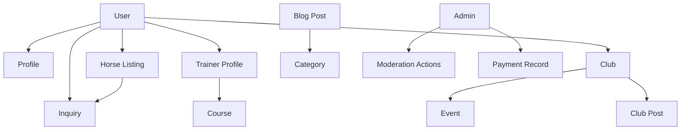

# LifeOnHorse Full Ecosystem Plan

## Product Vision
LifeOnHorse should become a global horse platform where horse owners, buyers, sellers, clubs, trainers, riding schools, breeders, experts, and fans can connect. The current static files in `[LifeOnHorse_FULL_LAUNCH](.)` are useful as an early concept, but the real product should be rebuilt as a secure full-stack web app.

## Recommended Platform
- Frontend: Next.js app for public pages, user dashboards, and admin UI.
- Backend: Supabase for database, authentication, file storage, row-level security, and admin workflows.
- Payments: start flexible because the business model is undecided. Add manual commission tracking first, then support paid listings, featured placements, subscriptions, and course payments.
- Deployment: Vercel or similar for the app, Supabase for backend services, Cloudflare for DNS/security.

## Core Modules

### 1. Public Website
- Homepage with featured horses, clubs, trainers, courses, events, and stories.
- About, contact, privacy, terms, safety, and trust pages.
- Country/region landing pages for Pakistan, India, Turkey, South Africa, Azerbaijan, Turkmenistan, and more later.

### 2. Authentication And Roles
- User accounts with email login.
- Roles: visitor, member, seller, trainer, club owner, course creator, moderator, admin.
- Profile completion flow after signup.
- Admin tools to suspend users and moderate content.

### 3. Horse Marketplace
- Horse listings for sale, adoption, stud service, lease, and wanted requests.
- Filters: country, city, breed, age, gender, price, discipline, color, height, purpose, verification status.
- Listing details: photos, videos, pedigree notes, health/vet info, seller details, location, inquiry button.
- Save/favorite listings and submit inquiries.
- Seller dashboard for managing listings and inquiries.

### 4. Club Registration And Club Directory
- Club registration is public immediately, based on your choice.
- Club types: polo, tent pegging, racing, riding school, breeding club, equestrian sports, rescue/sanctuary, cultural/traditional horse club, general horse community, other.
- Club profile: logo, photos, location, contact, social links, services, membership availability, training availability, events hosted, number of members/horses.
- Club owner dashboard to manage profile, events, posts, trainers, and linked horses.
- Admin can hide, remove, feature, or verify clubs if spam appears.

### 5. Trainers And Experts
- Directory for riding trainers, polo coaches, tent pegging trainers, vets, farriers, breeders, diet experts, stable managers, and transport/import-export agents.
- Profiles with specialties, location, experience, certifications, photos, contact methods, and reviews later.
- Trainer application and profile management.

### 6. Events
- Events for polo matches, tent pegging competitions, horse shows, riding camps, workshops, auctions, club meetups, rescue campaigns.
- Event pages with date, venue, host club, discipline, registration/contact info, and gallery.
- Event submission by clubs, trainers, and admins.

### 7. Courses And Learning
- Course catalog for horse care, riding basics, polo basics, tent pegging basics, grooming, feeding, breeding, stable management, buying guide, and horse business.
- Course detail pages with lessons, videos, downloads, and progress tracking later.
- Free content first, paid course support later.

### 8. Blog And Knowledge Base
- Articles for breeds, health, training, behavior, country-specific horse culture, marketplace safety, import/export, club guides, and event coverage.
- SEO-friendly categories and author profiles.
- Admin/editor workflow for publishing.

### 9. Community Features
- User stories and horse gallery.
- Contributor badges and certificates.
- Report abuse/spam button.
- Later: forum, discussion groups, virtual stable, horse name generator, pedigree tool.

### 10. Admin Dashboard
- Manage users, horses, clubs, trainers, events, courses, blog posts, reports, inquiries, and payments/commissions.
- Feature/unfeature content across homepage and directories.
- Moderate spam even when public submission does not require approval.
- Analytics dashboard for countries, active listings, inquiries, club registrations, and top content.

## Data Model Overview

## Business Model Plan
Because the business model is not decided yet, build revenue support in layers:
- Start with manual commission tracking and direct contact between buyer and seller.
- Add featured listings for horses, clubs, trainers, and events.
- Add paid listing packages if marketplace traction grows.
- Add memberships for sellers, trainers, and clubs if repeat users grow.
- Add paid courses once learning content is strong.
- Add country-specific payment options later, using the notes already captured in `[chat_extracted_2.txt](chat_extracted_2.txt)`.

## Build Strategy
Even though the goal is the full ecosystem, build it in controlled milestones so every stage is usable.

### Milestone 1: Foundation
- Set up Next.js app, Supabase project, auth, database schema, storage, layouts, navigation, and role system.
- Create public homepage and core directory shells.

### Milestone 2: Core Directories
- Build horse marketplace, club directory, trainer directory, and basic profile pages.
- Add create/edit flows for listings, clubs, and trainer profiles.
- Add inquiry/contact forms.

### Milestone 3: Admin And Moderation
- Build admin dashboard.
- Add manage, hide, feature, remove, verify, and report handling.
- Add analytics summary cards.

### Milestone 4: Events, Courses, Blog
- Add event creation and public event pages.
- Add course catalog and lesson structure.
- Add blog/CMS with categories and SEO metadata.

### Milestone 5: Monetization And Trust
- Add manual commission records.
- Add featured placement controls.
- Add verification badges.
- Add payment provider integration once the model is chosen.

### Milestone 6: Community Expansion
- Add user stories, horse gallery, certificates, badges, reviews, saved listings, and later discussion/forum features.

## Initial Product Rules
- Clubs publish immediately, but admin can moderate them later.
- Horse listings should either publish immediately with reporting or use optional admin review depending on spam risk.
- Payments should not block launch because international horse markets often rely on WhatsApp, bank transfer, and local payment methods.
- Secure auth and database permissions are required before any public launch.
- Plain-text admin credentials from `[Admin_Credentials.txt](Admin_Credentials.txt)` should not be used in the real app.

## Open Decisions To Finalize Later
- Final brand name: LifeOnHorse, Horse n Nature, or another name.
- Whether horse listings publish immediately or require approval.
- Whether trainers publish immediately or require verification.
- First launch countries.
- First payment model.
- Whether to support multiple languages in the first release.