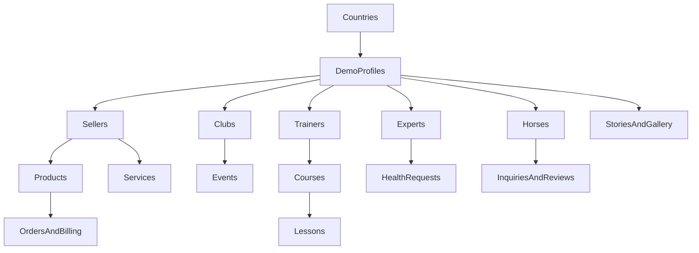

# Professional Demo Data And SEO Plan

## Goal
Replace the current placeholder seed in [`lifeonhorse-app/scripts/seed-demo.sql`](lifeonhorse-app/scripts/seed-demo.sql) with a complete professional demo dataset across the whole LifeOnHorse ecosystem. The demo should make the site feel like a real global horse platform while remaining safe to remove before production.

## Current State
The current seed file only inserts a small country subset and a commented example horse:

```12:16:lifeonhorse-app/scripts/seed-demo.sql
-- Example demo horse (requires a profile id - replace YOUR_USER_ID)
-- INSERT INTO horses (owner_id, title, description, breed, price, currency, country_code, city, status, photos)
-- VALUES ('YOUR_USER_ID', 'Demo Arabian Mare', 'Sample listing for staging tests', 'Arabian', 15000, 'USD', 'PK', 'Lahore', 'published', '[]'::jsonb);

COMMENT ON TABLE public.horses IS 'Demo seed: run manually after creating admin user. See README.';
```

The schema supports much richer content: horses, sellers, products, services, clubs, trainers, experts, health requests, events, courses, blog, community, billing, reviews, favorites, inquiries, reports, and analytics.

## Demo Strategy
Use **balanced professional seed data**:

- 5-10 polished records per major section
- Curated remote image URLs for staging/demo
- Realistic country distribution across global horse markets
- Demo marker convention for cleanup: `@demo.lifeonhorse.com`, `demo_` slugs/notes, or `admin_notes = 'demo'`
- Idempotent SQL using fixed demo UUIDs and `ON CONFLICT` where practical
- Cleanup script removes demo data safely without touching real users/content

## Demo Content Coverage

### 1. Countries
Expand [`lifeonhorse-app/scripts/seed-demo.sql`](lifeonhorse-app/scripts/seed-demo.sql) to seed a broader ISO country list, prioritizing horse/equestrian markets:

- Pakistan, India, Turkey, UAE, Saudi Arabia
- UK, Germany, France, Netherlands, Ireland
- USA, Canada, Mexico, Brazil, Argentina
- Australia, New Zealand, South Africa
- Azerbaijan, Turkmenistan and other regional markets

If the app already has a full country list in code, the seed should still ensure DB country rows exist for demo records.

### 2. Demo Users And Profiles
Create realistic demo profiles through SQL-safe profile records tied to known demo UUIDs if auth users are available, or document that auth users must be created first when foreign keys require `auth.users`.

Recommended personas:

- Admin/moderator demo profile
- Horse breeder
- Tack shop owner
- Feed supplier
- Transport/service provider
- Polo club manager
- Tent pegging club manager
- Trainer
- Equine vet/expert
- Community contributor

### 3. Horse Listings
Seed 8 horse listings with:

- Arabian mare in Pakistan
- Thoroughbred gelding in UK
- Akhal-Teke stallion in Turkmenistan
- Marwari horse in India
- Warmblood sport horse in Germany
- Quarter Horse in USA
- Polo pony in Argentina
- Rescue/adoption horse in South Africa

Each listing should include:

- Professional title
- Breed, age, gender, discipline, price, country/city
- 2-4 image URLs in `photos`
- SEO-style description with care, temperament, and suitability
- Featured flags on 2 listings

### 4. Seller Directory
Seed 5 seller profiles:

- Tack and saddle shop
- Feed/supplement supplier
- Breeder farm
- Trailer/stable equipment seller
- Club shop / equestrian boutique

Each seller should include:

- Logo/image URL
- Country/city
- Verified status for some sellers
- Business description
- Website/contact style fields

### 5. Product Marketplace
Seed 8 products:

- English saddle
- Polo mallet set
- Grooming kit
- Riding helmet
- Horse blanket
- Hoof care kit
- Feed supplement
- Stable mats or water system

Each product should include:

- Category
- Price/currency
- Product photos
- Stock/availability if supported
- Seller association
- SEO-friendly description

### 6. Service Marketplace
Seed 6 services:

- Horse transport
- Farrier service
- Vet visit / consultation
- Breeding service
- Riding photography
- Import/export documentation help

Each service should include:

- Category
- Country/city
- Pricing style
- Photos
- Clear contact/inquiry copy

### 7. Clubs
Seed 6 clubs:

- Polo club
- Tent pegging club
- Riding school
- Equestrian sports club
- Rescue/sanctuary
- Breeding association

Each club should include:

- Club type
- Logo/photos
- Member count
- Horse count
- Verified/featured examples
- Strong profile description

### 8. Trainers
Seed 6 trainer profiles:

- Riding instructor
- Polo coach
- Tent pegging trainer
- Dressage/jumping trainer
- Stable management trainer
- Youth riding instructor

Each trainer should include:

- Country/city
- Specialization
- Experience
- Photos
- Contact copy
- Verified examples

### 9. Horse Health And Experts
Seed 6 experts:

- Equine vet
- Farrier
- Equine dentist
- Nutrition expert
- Rehabilitation expert
- Behavior specialist

Seed 5 health requests:

- Hoof lameness
- Nutrition/weight loss
- Skin irritation
- Behavior issue
- Emergency transport inquiry

Every health request should include a safe disclaimer context and realistic, non-diagnostic language. Avoid fake definitive medical advice.

### 10. Events
Seed 6 events:

- Polo tournament
- Tent pegging championship
- Horse care workshop
- Riding camp
- Club open day
- Charity rescue event

Include date, venue, country/city, host, photos, and featured examples.

### 11. Courses And Lessons
Seed 4 courses, each with 3-5 lessons:

- Beginner Horse Care
- Buying Your First Horse Safely
- Polo Basics
- Stable Management And Feeding

Courses should include thumbnails, levels, free/paid status, and professional lesson descriptions.

### 12. Blog And SEO Content
Seed 8 blog posts with SEO-quality titles, excerpts, and content:

- How to Buy a Horse Safely
- Polo Horse Care Guide
- Tent Pegging Basics
- Common Horse Health Warning Signs
- Choosing the Right Saddle
- Feeding Horses in Hot Climates
- Building Trust With a New Horse
- Preparing for a Horse Show

Each post should include:

- Category
- Cover image URL
- SEO title and description where schema supports it
- 700-1200 words if desired, or concise demo article content for staging

### 13. Community
Seed:

- 4 user stories
- 6 gallery items
- 3 reviews for sellers/experts/clubs
- Badge assignments/certificates if tables exist

### 14. Monetization Demo
Seed:

- Billing plans already exist in [`lifeonhorse-app/supabase/migrations/003_monetization.sql`](lifeonhorse-app/supabase/migrations/003_monetization.sql)
- 2 featured listing requests
- 2 orders: one pending manual payment, one confirmed
- 1 subscription
- 2 commission records

This lets the admin billing dashboard show realistic activity.

## Image Guidelines
Because you chose remote licensed-style demo images:

- Use stable remote image URLs for staging
- Prefer horse/equestrian-relevant images
- Store image URLs in JSON arrays for `photos`
- Use different images per module to avoid repetitive UI
- Add comments that these are demo/staging image URLs and must be reviewed before production

Before public launch, replace demo image URLs with owned/licensed assets or uploaded Supabase Storage assets.

## SEO Improvements To Include With Demo Data
The seed should include content that improves page quality:

- Natural keyword-rich titles
- Country/city in titles and descriptions where appropriate
- Distinct excerpts for blog/course/listing cards
- Meta-style copy stored in available `seo_title` / `seo_description` fields where schema supports it
- Clean slugs/IDs if the schema supports slugs; otherwise clear titles
- Avoid duplicate titles and thin placeholder text

## Script Design
Update or create these files:

- [`lifeonhorse-app/scripts/seed-demo.sql`](lifeonhorse-app/scripts/seed-demo.sql)
  - Full professional demo seed
  - Idempotent where possible
  - Safe demo markers
- [`lifeonhorse-app/scripts/cleanup-demo.sql`](lifeonhorse-app/scripts/cleanup-demo.sql)
  - Removes demo records in dependency order
  - Does not remove real user content
- Optional: [`lifeonhorse-app/docs/DEMO_DATA.md`](lifeonhorse-app/docs/DEMO_DATA.md)
  - Explains how to seed, what is fake, and what to replace before launch

## Implementation Approach

1. **Map schema dependencies**
   - Profiles before sellers/trainers/clubs/horses
   - Sellers before products/services
   - Blog categories before blog posts
   - Courses before lessons
   - Entities before reviews/inquiries/orders/featured requests

2. **Create demo identity strategy**
   - Use fixed UUIDs for demo profiles/entities
   - If `profiles.id` requires real `auth.users`, either:
     - seed against an existing admin profile, or
     - provide a service-role JS seed that creates demo auth users first

3. **Seed core content**
   - Countries, profiles, sellers, horses, products, services, clubs, trainers, experts

4. **Seed supporting content**
   - Events, courses, lessons, blog, community, gallery, reviews

5. **Seed admin/monetization examples**
   - Reports, inquiries, orders, commissions, featured requests

6. **Verify pages**
   - Homepage
   - Marketplace horses/products/services/sellers
   - Clubs/trainers/events/courses/blog/community
   - Horse Health and experts
   - Admin analytics/billing/reports



## Verification Checklist
After implementing the seed:

- Run seed script on staging/dev only
- Confirm homepage has rich cards and images
- Confirm all major directories show non-empty content
- Confirm detail pages load
- Confirm admin analytics counts are non-zero
- Confirm cleanup script removes demo content
- Confirm `npm run build` still passes

## Risks And Controls

- **Foreign key risk:** `profiles` references `auth.users`, so SQL-only seed may fail without auth users. Control: use existing admin profile or add JS seed with service role.
- **Image licensing risk:** remote images are acceptable for staging but should be reviewed before production.
- **Cleanup risk:** demo cleanup must use explicit demo markers, not broad deletes.
- **Performance risk:** too much seed data can slow local dev. Control: balanced 5-10 records per module.

## Recommended First Implementation
Build a **service-role JS seed** plus SQL fallback:

- JS seed creates demo auth users safely using Supabase Admin API
- Then inserts rich demo records with fixed IDs
- SQL fallback can seed content using an existing admin profile if service role key is unavailable

This is the most professional and repeatable option.