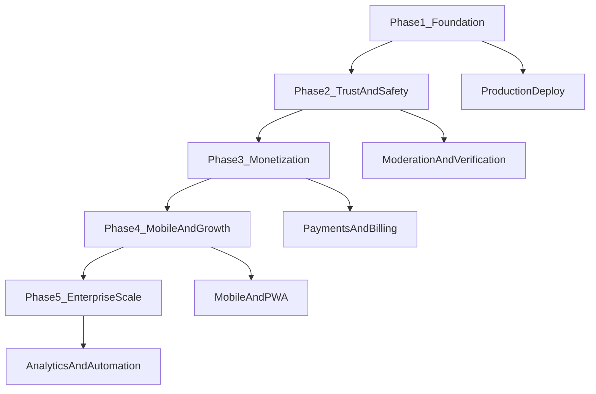

# LifeOnHorse Professional Upgrade Roadmap

## Current Baseline
LifeOnHorse already has a strong MVP in [`lifeonhorse-app/`](lifeonhorse-app/):

- Core modules: horses, products, services, sellers, clubs, trainers, events, courses, blog, community
- Horse Health & Expert Help: experts, health requests, safety disclaimer
- Supabase auth, storage uploads, admin moderation, worldwide country support
- Demo data seeded on project `ebgzqmnewtdippegphou`

Known gaps before professional launch:

- Invalid `SUPABASE_SERVICE_ROLE_KEY` in [`.env.local`](lifeonhorse-app/.env.local)
- Demo/test data still present
- No legal/compliance pages
- No production payment system
- No custom email provider
- No production deployment/domain hardening
- Dev server instability on local machine
- Some advanced features still partial (business docs upload, health video upload, seller dashboard hub)

## Strategic Goal
Transform LifeOnHorse from **working prototype** into a **professional global platform** with:

- Trust and safety
- Monetization
- Production reliability
- Legal readiness
- Mobile access
- Scalable operations

## Phase 1: Foundation And Launch Readiness (Weeks 1-4)

### Objectives
Make the platform stable, secure, and deployable.

### Workstreams
- **Environment hardening**
  - Fix `SUPABASE_SERVICE_ROLE_KEY`
  - Separate envs: local, staging, production
  - Add env validation on startup
- **Production infrastructure**
  - Deploy Next.js app to Vercel
  - Connect custom domain + Cloudflare SSL/DNS
  - Create production Supabase project or clean production dataset
- **Data cleanup**
  - Remove demo users/listings or mark as sample content
  - Replace placeholder images with owned/licensed assets
- **Legal pages**
  - Terms of Service
  - Privacy Policy
  - Cookie Policy
  - Marketplace Safety Policy
  - Horse Health Disclaimer
  - Seller/Buyer policy
- **Email system**
  - Configure custom SMTP/domain email
  - Test signup, reset password, notifications
- **Operational stability**
  - Fix local dev hang issues
  - Add health checks and error logging
  - Add staging smoke-test checklist

### Exit Criteria
- Production URL live on custom domain
- Legal pages published
- Email auth working reliably
- No secrets misconfigured
- Admin and public flows tested on staging

## Phase 2: Trust, Safety, And Professional Operations (Weeks 5-10)

### Objectives
Make the platform safe for real users, sellers, vets, and clubs.

### Workstreams
- **Verification system**
  - Verified seller badge
  - Verified expert/vet badge
  - Verified club badge
  - Document upload for business/license proof
- **Moderation upgrade**
  - Expand report handling across all entity types
  - Admin review queue for flagged content
  - Suspend/ban workflows
  - Audit log for admin actions
- **Health safety**
  - Stronger emergency disclaimer on health request flow
  - Urgent case routing to admin
  - Expert profile review before featured placement
- **Content quality**
  - Required fields and validation on all create forms
  - Image moderation rules
  - Spam/rate limits on submissions
- **Support operations**
  - Contact/support center page
  - Admin notes on sellers, experts, health requests
  - Internal status workflow for health requests

### Exit Criteria
- Verification and moderation usable by admin daily
- Health requests handled with clear safety messaging
- Spam and abuse controls in place
- Trust badges visible on public profiles

## Phase 3: Monetization And Payments (Weeks 11-18)

### Objectives
Turn LifeOnHorse into a revenue-capable business platform without breaking international horse-market realities.

### Recommended payment model
Use a layered model instead of one global checkout:

1. **Manual commission tracking** (already started)
2. **Featured listings**
3. **Seller/club subscriptions**
4. **Course payments**
5. **Country-specific payment providers later**

### Workstreams
- **Billing foundation**
  - Plans table: free, featured, premium seller, club premium, expert premium
  - Orders/invoices/payment status tables
  - Admin billing dashboard
- **Featured placements**
  - Paid featured horses, products, services, clubs, experts, events
- **Seller monetization**
  - Seller shop subscriptions
  - Product listing packages
  - Service promotion packages
- **Course monetization**
  - Free/paid course support
  - Purchase records and access control
- **Country-aware payments**
  - Stripe for international cards
  - Razorpay/UPI for India
  - Manual bank transfer/JazzCash/Easypaisa/PayFast notes for other regions
  - Payment proof upload for manual settlement
- **Commission engine**
  - Record deal value, commission %, payment status, admin confirmation

### Exit Criteria
- At least one paid revenue stream live
- Admin can track commissions and featured purchases
- Payment failure/refund states handled
- Country payment guidance integrated into seller/buyer flows

## Phase 4: Mobile, Growth, And User Experience (Weeks 19-24)

### Objectives
Make LifeOnHorse feel like a modern product users can access anywhere.

### Workstreams
- **Mobile UX polish**
  - Responsive pass on all major pages
  - Faster homepage and listing cards
  - Better mobile forms and image upload UX
- **PWA**
  - Installable web app
  - App icon, splash, offline basics
- **Native app foundation**
  - Expo/React Native app using same Supabase backend
  - Auth, marketplace browse, clubs, health experts, profile
- **Growth features**
  - SEO metadata for listings, clubs, experts, blog
  - Country landing pages
  - Newsletter signup
  - Social sharing cards
- **Engagement**
  - Saved favorites everywhere
  - Inquiry inbox for sellers/trainers/experts
  - Notifications for new inquiries and admin actions

### Exit Criteria
- PWA installable
- Mobile UX acceptable on phone
- Expo app MVP ready for internal testing
- SEO and sharing basics in place

## Phase 5: Enterprise Scale And Advanced Ecosystem (Months 5-6)

### Objectives
Build the features that make LifeOnHorse a true long-term ecosystem, not just a directory.

### Workstreams
- **Advanced marketplace**
  - Multi-image galleries per listing
  - Inventory for products
  - Seller analytics dashboard
  - Import/export service workflows
- **Advanced health platform**
  - Expert consultation booking
  - Case history per horse
  - Video upload on health requests
  - Paid consultation support
- **Community expansion**
  - Reviews and ratings
  - Forum or Q&A
  - Contributor certificates automation
  - Virtual stable / pedigree tools
- **Automation**
  - Email notifications
  - Admin alerts
  - Analytics dashboard
  - Search improvements and saved searches
- **App store launch prep**
  - Google Play submission
  - Apple App Store submission
  - Privacy, support, and store compliance assets

### Exit Criteria
- Seller and expert dashboards mature
- Health and marketplace workflows support repeat business
- Mobile app submission-ready
- Analytics and automation reduce manual admin work

## Recommended Delivery Order

| Month | Focus |
|------|-------|
| Month 1 | Production deploy, legal, email, security, cleanup |
| Month 2 | Verification, moderation, trust, health safety |
| Month 3 | Payments foundation, featured listings, commissions |
| Month 4 | Subscriptions, course payments, seller billing |
| Month 5 | PWA + mobile app MVP + SEO/growth |
| Month 6 | Reviews, advanced dashboards, app store prep |

## Priority Fixes Before Any Public Launch
These should happen before marketing the site publicly:

1. Fix service role key and production env setup
2. Remove or clearly label demo content
3. Publish legal and health disclaimers
4. Configure custom email
5. Complete moderation and verification workflow
6. Test uploads, inquiries, admin actions on production
7. Add monitoring and backup plan

## Suggested Team / Ownership Split
If you want this done professionally over 3-6 months:

- **Product owner**: you
- **Full-stack dev**: web app, Supabase, admin, payments
- **Designer**: homepage, mobile UX, trust pages, seller dashboards
- **QA/tester**: flows, forms, uploads, payments, mobile
- **Legal/compliance support**: terms, privacy, marketplace/health disclaimers
- **Marketing/ops**: launch countries, social, seller onboarding

## Success Metrics
Track these monthly:

- Registered users
- Active sellers
- Horse/product/service listings
- Club and expert registrations
- Inquiries submitted
- Health requests submitted
- Verified profiles
- Featured listing revenue
- Commission recorded
- Mobile visits and PWA installs

## Immediate Next Step
Start with **Phase 1 only**. Do not jump to payments or mobile apps until production, legal, email, and moderation are solid.

Recommended first implementation sprint:

1. Production deploy + domain
2. Legal pages + health disclaimer
3. Service role/env cleanup
4. Demo data cleanup
5. Admin verification workflow polish
6. End-to-end staging test checklist